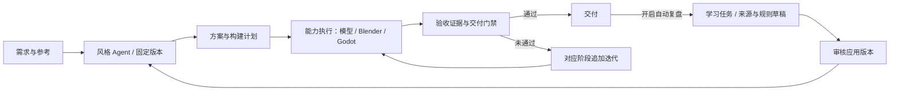

# Agent 工作台架构

更新：2026-10-05。本文区分当前实现和后续设计，不把规划能力标记为已完成。

## 产品主线

系统以风格 Agent 为创作入口。用户先选择“谁来引领创作”，再描述需求；模型、Blender、Godot 和评分服务负责执行。风格定义不再散落在页面和单次提示词中，而是有独立身份、基础规则、学习来源和可切换版本。



失败作品也可以手动加入学习任务，作为反例分析。自动复盘目前仅在创作成功通过交付阶段后按任务选项排队，避免无条件重试或递归学习。

## 当前实现

| 层 | 代码 | 职责 |
|---|---|---|
| 入口与身份 | `console/auth.py`、`static/login.*` | 单机账户、加盐 scrypt 密码哈希、HttpOnly 会话；无默认密码 |
| 风格注册与知识 | `style_agents.py`、`agents/oskar.json` | Agent 定义、来源研究、版本草稿、审核应用、基础规则回退 |
| 创作编排 | `pipeline.py` | 四种创作模式与 `learn` 研究模式；提交时固定 Agent 规则快照 |
| 能力调用 | `llm.py`、`vision.py`、`mcp_hub.py` | 推理、生图、分割、评分、引擎工具；与 Agent 身份分离 |
| 本机执行调度 | `compute.py`、`services.py` | FIFO 重任务准入、服务租约、内存估算预算、排队与执行耗时 |
| 验收 | `quality.py` | 工作台与交付共用的验收判定；不以 `done` 或 zip 存在代替通过 |
| 工作界面 | `static/workspace.js`、`static/workspace.css` | 工作台总览、系统 Agent、下一步操作、质量检查、资源状态 |

### 风格 Agent 生命周期

1. 内置 Oskar 的定义来自 `agents/oskar.json`；新 Agent 可在系统 Agent 页面创建。
2. 当前新 Agent 复用 Oskar 构建引擎，通过自己的基础规则与学习版本指导造型、配色和空间组织。增加全新的构建引擎仍需要代码适配。
3. 创建创作任务时，将 Agent 的当前规则完整复制到 `options.style_profile`。正在运行和历史任务不会随版本切换而改变。
4. 风格快照进入方案规划、蓝图建模、自由建模、Oskar 场景规划与迭代、Godot 组装提示。工具 schema、目标图和硬检查仍然约束结果。
5. 学习任务读取注册参考文档、最多 5 个选定运行的证据，以及用户给出的研究重点。它不自动浏览外部网站，也不修改模型权重。
6. 本地 LLM 输出带来源 ID 的规则；校验来源和字段后写成独立版本。材料快照随版本保留，避免来源之后改变而无法核对。
7. 页面展示规则、来源、创建时间和学习任务。点击“审核并应用”后用于新创作；可恢复基础规则或切换到其他已有版本。

### Oskar 的继承知识

2026-10-05 融合 TigerMessenger 与本仓研究，形成 `agents/knowledge/oskar/`：八个方法模块、十份来源笔记的本地快照与 SHA-256。保留本引擎的确定性场景程序与受限迭代，补充配色、真实岩台、模块内部通行、地表生态、线条、树云、岸浪和证据方法。旁边项目只读，当前运行不依赖它存在。

`style_profile` 同时固定 Agent 定义指纹、学习版本、知识版本、模块内容与来源指纹。不同阶段只注入相关方法；验收提示显式要求以实际目标图和渲染为准，不把风格文字变成虚构的视觉证据。学习任务将模块作为独立可引用的来源，后续草稿保留所依据的知识版本。

“系统 Agent → 方法与能力”可展开每个模块，查看可用能力、尚缺实现、验收方法与归档来源。来源读取要求登录，并校验快照指纹。基础知识随代码发布，用户学习版本仍需审核。恢复基础规则只停用用户学习档案，不删除内置融合知识。

导入的是已有研究与决策方法，没有训练权重、移植 TigerMessenger 的 Three.js 运行时代码或重新观看原媒体。树云 shader、顶点岸浪、球面表面版本合同等都保持为待适配。图库使用 2026-09-29 的本引擎渲染，并明确标为融合前样本。

文件位置：

- 内置定义：`agents/*.json`。
- 用户定义：`data/agents/registry/*.json`。
- 学习版本及来源快照：`data/agents/<agent_id>/profiles/*.json`。
- 当前版本指针：`data/agents/<agent_id>/active.json`。
- 每次学习的可下载产物：`runs/<learning_run>/style_draft.json`。
- 账户：`data/auth.json`，权限为 `0600`；会话保存在进程内，12 小时有效，重启后重新登录。

`data/` 与 `runs/` 不入 Git。迁移时必须单独保存 Agent 知识、项目产物和所需账户文件；仅复制代码不能恢复这些内容。

### 工作台信息结构

- **总览**：执行中任务、需要判断的任务、已记录检查通过的任务；突出审批、失败和验收缺口。
- **系统 Agent**：选择 Agent、查看风格档案、安排研究、应用版本、查看关联创作；可新增风格 Agent。
- **创作记录**：按项目分组，可搜索，并按全部 / 待处理 / 进行中筛选。
- **任务详情**：分别呈现执行状态、Agent 版本和质量状态；保留目标、资产、游戏、日志与产物页面。
- **质量检查**：每项检查呈现证据和对应阶段。建模与组装可追加 2 轮；建模会显式重访未合格资产，不再因已有 GLB 自动跳过。
- **资源区**：当前算力操作、排队数量、耗时、模型驻留估算和系统实际内存；窄屏可通过“服务与算力”打开资源管理。

### 本机调度边界

当前默认单个受管理的重调用执行，允许多个模型在预算内驻留。这样既减少推理与渲染相互争抢，也不必在每次切换小任务时卸载模型。

- `memory.gpu_budget_gb = 48`，`memory.engine_reserve_gb = 8`，因此模型驻留估算上限为 40 GB。
- 入场前先计算可驱逐的空闲服务；即使全部允许的驱逐完成仍放不下，则拒绝启动，且不会为了一个不可能的请求先卸载其他服务。
- 从模型启动到响应/流结束持有租约；活动服务不可被自动驱逐或控制台手动停止。
- 排队取消会移除请求；运行中取消等待当前调用收尾后才释放调度槽。队列默认超时 1800 秒。
- 排队、执行、完成、失败、取消事件记录到运行日志，包含任务与阶段。执行耗时包含按需启动时间，尚未细分模型加载与推理时间。

这不是操作系统级 GPU 锁或内存硬限制。独立 MCP 客户端、外部模型调用、其他应用和另一个控制台进程不受此进程内队列协调；传输超时也不能证明后端 GPU 工作已终止。Blender/Godot 的内存目前采用固定预留，还没有按场景规模预测峰值。

### 交付门禁

`quality.assess()` 用于界面和正式交付，结果为 `passed`、`blocked` 或 `unverified`。只允许已记录的必需检查通过后进入打包。旧运行不修改数据库里的历史执行状态，而是在页面重新计算其证据状态。

- 资产：导出记录、导出版本的视觉验收和硬检查。
- 游戏：上述资产检查，加最终试玩硬检查、视觉验收，以及已生成世界的必需硬检查。
- Oskar 场景：导出、场景硬检查、Godot 核对及跨引擎相似度证据；兼容旧版本把 GLB 记录放在 `models.oskar_scene` 的结构。
- 旧场景：子资产与组装分门槛。
- 学习：独立标记为草稿待审核，不当作游戏交付。

通过这些记录仍不代表完整玩法、全地图可达性、文件重新导入或人工美术验收已完成。这些是后续增加的验收能力，不由界面标签推断。

## 下一阶段设计

1. **算力后端分工**：风格身份与知识已从底层调用中抽离；执行目前仍使用现有本地服务。云端 / 本地的具体职责待产品选择后接入，不在本轮自动调用云端服务。
2. **候选任务与产物依赖图**：将长阶段拆成带输入指纹、输出清单和版本的任务，按依赖失效；复用不变的参考解析和渲染结果，支持几何多初稿择优。
3. **分层评估**：确定性硬检查 → 客观特征比较 → 必要的视觉模型评审 → 人工风格验收，限制无效补丁与重复长上下文推理。
4. **能力预算**：区分模型加载、推理、渲染与等待时间，测量任务峰值；有证据后再开放 CPU 轻任务并行，不能简单增加重模型并发数。
5. **Agent 成长验证**：同一组固定目标分别用基础版与学习版创作，对比人工认可、硬检查、耗时和回退率。规则更多不等于风格更好。
6. **玩法验证**：为竹林信使建立出生 → 拾取 → 投递 → 完成任务的自动测试，补充边界、可达性与相机检查。

## 验证与运行

```bash
.venv/bin/python -m pytest -q
scripts/start.sh
```

首次打开控制台先创建本机账户。API 也要求登录会话；`scripts/eval_modelers.py` 会在交互终端请求登录。

只读检查历史记录时，可使用独立端口，避免启动任务与模型：

```bash
GENAI_CONSOLE_READ_ONLY=1 .venv/bin/python -m uvicorn genai_pipeline.console.app:app --host 127.0.0.1 --port 18700
```

只读模式仍需要登录；身份操作可用，项目和服务的写操作被拒绝。开发测试可通过 `GENAI_AUTH_FILE` 指定独立测试账户文件，避免触碰实际账户。

## 邀请风格顾问修改现有作品（2026-10-05 新目标）

用户期望：系统可学习不同游戏设计师的公开作品、访谈和方法，形成多个可持续积累的风格 Agent；在已有项目中邀请指定 Agent，提出并实施修改。设计师身份以用户确认的资料为准，界面描述为基于资料学习的风格顾问。

目标流程为「选择学习资料 → 提炼带来源的风格规则 → 审核并启用版本 → 邀请到现有作品 → 审阅与提案 → 选择修改范围 → 创建改版 → 比较与验收」。学习维度应覆盖视觉、角色与道具、关卡空间、玩法反馈、叙事节奏；每个维度标注实际支持的执行能力。原有 Oskar 引擎只是执行后端之一，不应成为所有设计师共同的身份标签。

邀请时固定 Agent 的规则版本、来源摘要和被审阅作品的版本。修改应写入独立的派生运行，记录父任务 ID、改动意图、允许修改范围及保留约束，保留原作。重新生成的结果必须重新验收；沿用原作截图、评分或交付状态不能作为改版通过的证据。只有已经实现的能力展示为可执行，暂未支持的玩法或叙事修改提供建议。

当前已有：多 Agent 注册、带来源的学习草稿、手动启用与切回基线、任务固定风格快照、生成阶段注入规则。已补齐资料库：UTF-8 Markdown／文本导入或粘贴，每份最多 8000 字，可选资料最多 50 份；研究可选 8 份，入队保存正文与 SHA-256，归档可恢复。任务页显示固定资料，已排队研究不受后续归档或新导入影响。

已实现邀请入口与 consult 模式：提交时固定原作方案、验收事实、最多三张渲染图及风格快照，图像校验 SHA-256；提案必须属于选定范围并引用已存在来源。最近渲染样本不宣称等同最终导出，无图时明确没有完成视觉审阅。

单资产的视觉或角色提案可勾选并派生独立 asset 任务。邀请时复制原作任务目录内的单个 GLB（最多 128 MB）；改版再次复制模型，以固定 Agent 版本和所选建议引领规划、建模、验收，概念图需人工确认。新任务没有旧状态、评分或交付物，重复提交同一选择返回同一子任务。执行和重跑前再次检查原模型路径与 SHA-256，避免准备失败或文件改变后悄悄退化成全新创作。任务初始化失败会保存失败状态与错误事件，不再留下虚假的运行中状态。原作、提案、改版之间可跳转；完整游戏和场景暂不自动执行改版。

已实现原作与改版对照：原作质量记录和渲染样本随改版复制，删除原作或提案后仍可核对；改版一侧只展示自己的检查与渲染，不沿用旧结论。提案列出派生任务及状态，逐项标识已安排的建议。渲染样本不保证最终版本或同机位，验收记录不自动转换成质量提升分数。

待实现：多版本分支管理、自动同机位渲染与逐项建议完成验证、更多执行能力的分范围适配。本轮实际模型审阅与改版效果尚未运行，流程通过脚本回复与隔离任务验证。
